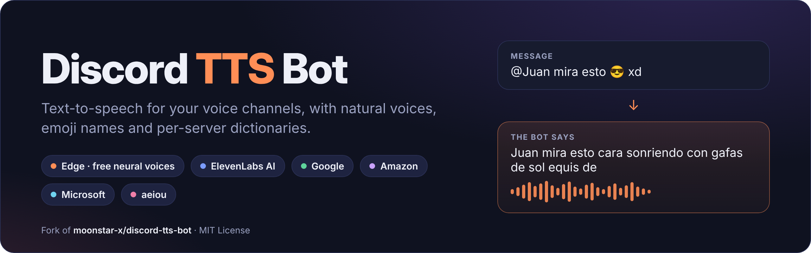
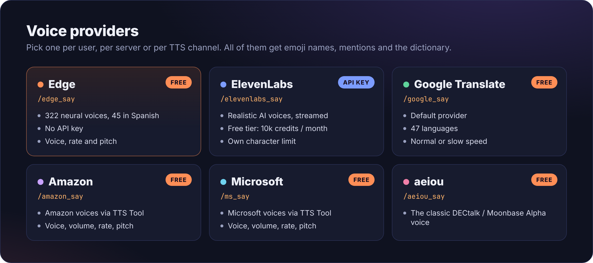
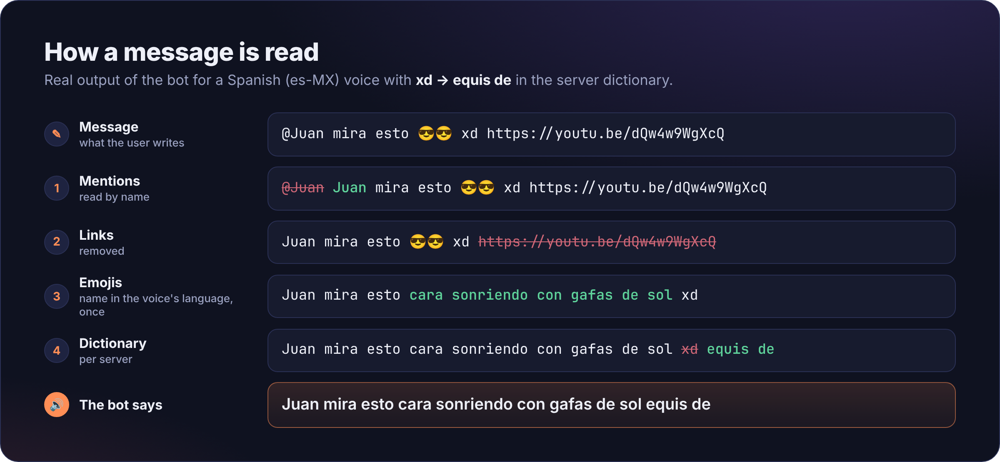

[](https://github.com/xjuanfxx/discord-tts-bot/actions)
[](https://github.com/xjuanfxx/discord-tts-bot/issues)

# Discord TTS Bot

This is a simple TTS Bot that uses the Google Translate TTS API. With this bot you can send Text-to-Speech messages in multiple languages using Google Translate or other TTS engines (Microsoft Edge neural voices, Amazon, Microsoft, aeiou and ElevenLabs AI).

> 💛 **Based on [discord-tts-bot](https://github.com/moonstar-x/discord-tts-bot) by [moonstar-x](https://github.com/moonstar-x).** This fork adds new voice providers, smarter text processing and many fixes on top of the original bot. All the credit for the original idea and code goes to its author, see [Credits](#credits). For the documentation of the original bot, visit its [official page](https://docs.moonstar-x.dev/discord-tts-bot/).

## What's new in this fork

* **Microsoft Edge provider (free)**: natural sounding neural voices (322 voices, 45 in Spanish) with `/edge_say`, no API key needed. See [Edge](#edge).
* **ElevenLabs AI provider**: realistic AI voices with `/elevenlabs_say`. Everything (API key, voice, model, voice settings, character limit) is set from the [configuration](#configuration). See [ElevenLabs](#elevenlabs).
* **Emojis are read out loud by their name** in the language of the voice: 😎 → *"cara sonriendo con gafas de sol"* (es) / *"smiling face with sunglasses"* (en). Custom server emojis are read by their name, skin tones are omitted and repeated emojis are only read once.
* **Mentions are read by name**: `@Juan`, `#general` and `@Mods` instead of being skipped.
* **Per-server dictionary**: make the bot read words in a different way, e.g. `xd` → `equis de` (`/dictionary_add`, `/dictionary_remove`, `/dictionary_list`).
* **Character limits**: a global limit (`max_message_length`), a per-provider limit (`elevenlabs_max_message_length`) and a per-server limit with `/set_max_length` that can never go above the global one.
* **Low latency**: the audio is generated while the bot joins the channel, the next parts are downloaded and decoded while the current one plays (no gaps), ElevenLabs audio is streamed and messages always play in order.
* **`/skip`** skips the message that is being said.
* **Leaves the voice channel when everyone else leaves** (`leave_when_alone`).
* **Ignore prefix for TTS channels**: messages starting with `//` are not read (`tts_channel_ignore_prefix`).
* The *"User said"* intro is translated (*"Juan dijo"*, *"Juan a dit"*).
* **Hardened voice connection**: the bot joins self-deafened (but not muted), uses Discord's end-to-end encrypted voice (DAVE), recovers when moved between channels, cleans up when kicked, never hangs when it can't connect, tells you when it has been server muted and can speak in stage channels.
* **Follows Discord's guidelines**: only requests the privileged *Message Content* intent when TTS channels are enabled, doesn't keep message contents in the logs (only in debug mode) and doesn't spam warning replies in TTS channels.
* **Safer configuration**: if `settings.json` has a mistake the bot tells you the line and column without printing its contents (your token and keys never end up in the console), and `""` or `"null"` are treated as "not set".
* **Ready for modern hosting**: Node.js 22, npm 12 (install scripts allowed for the native audio packages) and a [startup command for Pterodactyl panels](#running-on-a-pterodactyl-panel) that updates the bot and deploys the commands automatically.



## Requirements

To self-host this bot you'll need the following:

* [git](https://git-scm.com/)
* [node.js](https://nodejs.org/en/) (Version 22.12.0 or higher, required by `@discordjs/voice`)
* ffmpeg

**ffmpeg** should be installed by default on Linux and MacOS, in case it isn't, install it with your package manager. For Windows users, head over to [ffmpeg's official website](https://www.ffmpeg.org/download.html#build-windows) to download the binary which will need to be added to your **\$PATH**. If you don't know how to add folders to your **\$PATH**, check out this [guide](https://www.architectryan.com/2018/03/17/add-to-the-path-on-windows-10/).

You may also try installing it with:

```text
npm install ffmpeg-static
```

## Installation

In order to self-host this bot, first you'll need to clone this repository.

```text
git clone https://github.com/xjuanfxx/discord-tts-bot.git
```

Install the dependencies with:

```text
npm ci --omit=dev
```

Or, if you want to also install the `devDependencies`:

```text
npm install
```

After you have [configured](#configuration) the bot, you should deploy the slash commands by running:

```text
npm run deploy
```

Then, you can run your bot with:

```text
npm start
```

In case your bot is in a lot of servers (more than 2000), you should shard your bot. You can start a sharded client with:

```text
npm run start-sharded
```

## Updating

In order to update this bot, you should pull the latest changes:

```text
git pull origin master
```

And re-install the dependencies:

```text
rm -rf node_modules && npm install
```

Once this is done, you should re-deploy the commands:

```text
npm run deploy
```

And you're ready to go. Make sure you check the README everytime you wish to update in case there are breaking changes
that may affect your current installation.

### Upgrading from 4.2.x to 4.3.0

* **Node.js 22.12 or newer is now required** (it's required by `@discordjs/voice`, which handles Discord's encrypted voice). Check your version with `node -v` before updating.
* Run `npm install` (there are new dependencies) and `npm run deploy` (there are new commands).
* The new settings are optional, your current `settings.json` keeps working. If you already had `elevenlabs_api_key`, it is used as is.
* Emojis are now read by their name. Set `enable_emoji_names` to `false` to keep skipping them.

## Creating your Bot Token

Head over to [Discord Application Page](https://discord.com/developers/applications/) and create a new bot. Then, you should enable it as a bot
by going into the `Bot` page and setting up your bot. Then, you should head over to the `OAuth2` page and select `OAuth2 URL Generator`. A box should show up
with plenty of checkboxes, enable the `bot` and `application.commands` checkboxes. Then, another box should show up with more checkboxes, enable the following ones:

* Send Messages
* Read Message History
* Connect
* Speak

If you want the bot to talk in stage channels, also give it the *Mute Members* permission (or a moderator will have to accept its request to speak).

> The bot only needs the privileged **Message Content** intent if you enable `enable_tts_channels`. You can leave it disabled otherwise.

At the bottom a link should show up, access this link to invite your bot. You should send this link to anyone that wishes to add your bot to their Discord server.

## Configuration

Inside the `config` folder, rename the file *settings.json.example* to *settings.json* and edit it with your own Discord token and other settings. If you don't have a Discord token yet, see [Creating your Bot Token](#creating-your-bot-token).

<details>
<summary>Full <code>settings.json</code> example</summary>

```json
{
  "token": "YOUR_DISCORD_TOKEN",
  "prefix": "$",
  "owner_id": "123123123",
  "owner_reporting": false,
  "presence_refresh_interval": 600000,
  "default_disconnect_timeout": 5,
  "testing_guild_id": "",
  "provider_type": "level",
  "redis_url": "redis://ip:port",
  "enable_tts_channels": false,
  "enable_keep_alive": false,
  "enable_who_said": false,
  "max_message_length": 0,
  "enable_emoji_names": true,
  "leave_when_alone": true,
  "tts_channel_ignore_prefix": "//",
  "edge_voice": "en-US-AriaNeural",
  "elevenlabs_api_key": "",
  "elevenlabs_voice_id": "EXAVITQu4vr4xnSDxMaL",
  "elevenlabs_model_id": "eleven_flash_v2_5",
  "elevenlabs_language": "en",
  "elevenlabs_stability": 0.75,
  "elevenlabs_similarity_boost": 0.75,
  "elevenlabs_style": 0.3,
  "elevenlabs_speaker_boost": true,
  "elevenlabs_output_format": "mp3_44100_128",
  "elevenlabs_max_message_length": 0
}
```

</details>

Every setting can also be set with an environment variable: `DISCORD_` + the setting in uppercase (e.g. `max_message_length` → `DISCORD_MAX_MESSAGE_LENGTH`). Environment variables take precedence over the JSON file. Only `token` is required.

> **Keep the double quotes**: text values like the token, IDs and API keys always go between quotes, e.g. `"elevenlabs_api_key": "sk_..."`. Numbers (`0`, `0.75`) and `true` / `false` don't. If the file has a mistake, the bot tells you the line and column without printing its contents.

#### General

| Setting | Default | Description |
|---|---|---|
| `token` | — | **Required.** The bot's token. |
| `owner_id` | `null` | ID of the bot's owner. |
| `owner_reporting` | `false` | DM the owner when a command errors. |
| `presence_refresh_interval` | `900000` | Milliseconds between presence updates. `null` disables it. |
| `default_disconnect_timeout` | `5` | Minutes of inactivity before leaving the voice channel (servers can change it with `/set_timeout`). |
| `testing_guild_id` | `""` | Guild to deploy the commands to while developing. |
| `provider_type` | `level` | Data storage: `level` (a local file, small bots) or `redis` (sharded bots). |
| `redis_url` | `null` | Redis URL, only for `provider_type: redis`. |
| `enable_keep_alive` | `false` | Start an HTTP server to keep the bot alive on Repl.it / Heroku (uses the `PORT` env var). |
| `prefix` | `$` | *Deprecated*, the bot uses slash commands. |

#### Text-to-speech

| Setting | Default | Description |
|---|---|---|
| `enable_tts_channels` | `false` | Read every message sent to the channels set with `/set_channel_provider`. Requires the privileged *Message Content* intent. |
| `tts_channel_ignore_prefix` | `//` | Messages starting with this are not read in TTS channels. `null` reads everything. |
| `enable_who_said` | `false` | Start each message with *"User said"* (translated to the server's locale). |
| `enable_emoji_names` | `true` | Read emojis by their name (😎 → *smiling face with sunglasses*) instead of skipping them. |
| `leave_when_alone` | `true` | Leave the voice channel 15 seconds after everyone else has left. |
| `max_message_length` | `0` | Max characters per message (`0` = no limit). See [character limits](#character-limits). |

#### Edge

| Setting | Default | Description |
|---|---|---|
| `edge_voice` | `en-US-AriaNeural` | Default voice for the Edge provider (e.g. `es-MX-DaliaNeural`). See `/edge_voices`. |

#### ElevenLabs

| Setting | Default | Description |
|---|---|---|
| `elevenlabs_api_key` | `""` | Your [ElevenLabs](https://elevenlabs.io) API key. The provider is disabled without it. |
| `elevenlabs_voice_id` | `EXAVITQu4vr4xnSDxMaL` | Default voice. Get the IDs with `/elevenlabs_voices`. |
| `elevenlabs_model_id` | `eleven_flash_v2_5` | Model. `eleven_flash_v2_5` is the fastest (best for a TTS bot), `eleven_multilingual_v2` and `eleven_v3` are more expressive but slower. |
| `elevenlabs_language` | `en` | Language of your voices, used to read emoji names. |
| `elevenlabs_stability` | `0.75` | Voice stability (0 - 1). |
| `elevenlabs_similarity_boost` | `0.75` | Similarity to the original voice (0 - 1). |
| `elevenlabs_style` | `0.3` | Style exaggeration (0 - 1). |
| `elevenlabs_speaker_boost` | `true` | Use speaker boost. |
| `elevenlabs_output_format` | `mp3_44100_128` | Audio format requested to ElevenLabs. |
| `elevenlabs_max_message_length` | `0` | Max characters per message for ElevenLabs only (`0` = use `max_message_length`). |

## Running on Docker

The `moonstarx/discord-tts-bot` image on Docker Hub is the original bot and does not include the changes of this fork, so build the image yourself:

```text
docker build -t discord-tts-bot .
```

Before you run this image, you should deploy your commands, you can do so by running:

```text
docker run -it --rm -e DISCORD_TOKEN="your_token" -e DISCORD_ENABLE_TTS_CHANNELS="true/false" discord-tts-bot npm run deploy
```

After that, you can start a container with the bot's image by running:

```text
docker run -it -e DISCORD_TOKEN="YOUR DISCORD TOKEN" discord-tts-bot
```

Check [configuration](#configuration) to see which environment variables you can use.

The following volumes can be used:

* `/opt/app/config`: The config folder for the bot, here you can use the `settings.json` file to configure the bot if you don't want to use environment variables.
* `/opt/app/data`: The data folder for the bot. If you use a `level` data provider you should set this volume to keep the bot's data persistent across restarts.

## Running on a Pterodactyl panel

On hosting panels based on Pterodactyl (with a Node.js egg), use a **Node.js 22** image, leave *Additional Node Packages* empty and set the **Startup Command** to:

```bash
if [[ ! -d .git ]]; then git init && git remote add origin https://github.com/xjuanfxx/discord-tts-bot.git; fi; git fetch origin master && git reset --hard origin/master; /usr/local/bin/npm install --omit=dev --no-audit --no-fund; H=$(cat src/command-deployer.js $(find src/commands -type f | sort) | md5sum | cut -d' ' -f1); if [[ "$H" != "$(cat .deployed-hash 2>/dev/null)" ]]; then /usr/local/bin/node /home/container/src/command-deployer.js && echo "$H" > .deployed-hash; fi; /usr/local/bin/node /home/container/src/app.js
```

On every start it:

1. Downloads the bot the first time, and the latest version of `master` on the next starts. Your `config/settings.json` and `data/` folder are never touched (git ignores them).
2. Installs the dependencies.
3. Deploys the commands to Discord, only when they changed since the last time.
4. Starts the bot.

So to update the bot you just restart the server. Upload your `config/settings.json` with the file manager. If you change `enable_tts_channels`, delete the `.deployed-hash` file so the commands are deployed again.

## Running on Repl.it

To run this bot on Repl.it, create a new Repl by importing this repository. Then, run the following commands:

```bash
chmod +x init-replit.sh
./init-replit.sh
```

This will set up the proper node environment for the bot.

Then, after you have [configured](#configuration) your bot, you should deploy your commands and start the bot with:

```text
npm run deploy
npm start
```

Make sure to have `enable_keep_alive` set to `true` and use UptimeRobot to poll the address that shows up for your repl to make sure it stays on 24/7.

## Deploying to Heroku

To deploy to Heroku, you can click on the image below and login to your account.

[](https://heroku.com/deploy?template=https://github.com/xjuanfxx/discord-tts-bot)

You can now go back to your app's *Overview*, make sure you disable the *web* dyno and enable the *bot* dyno. Your bot should now be up and running. Remember you can always check your bot's console if you access the *View Logs* in the *More* dropdown menu.

## Usage

🔒 = requires *Manage Server* · 📌 = requires *Manage Channels* and `enable_tts_channels`

#### General

| Command | Description |
|---|---|
| `/say <message>` | Say a message in your voice channel with your settings (or the server's). |
| `/skip` | Skip the message that is being said. |
| `/stop` | Stop and leave the voice channel. |
| `/my_settings` · `/default_settings` | Show your settings / the server's default settings. |
| `/set_my_provider <provider>` · `/set_default_provider <provider>` 🔒 | Choose the provider used by `/say` for yourself / the server. |
| `/set_locale <locale>` 🔒 | Language of the bot's replies (`en`, `es`, `fr`). |
| `/set_timeout <minutes>` 🔒 | Minutes of inactivity before leaving the channel. |
| `/set_max_length <length>` 🔒 | Max characters per message in this server (`0` removes it). |
| `/dictionary_add <word> <replacement>` 🔒 · `/dictionary_remove <word>` 🔒 · `/dictionary_list` | Read words differently in this server (e.g. `xd` → `equis de`). |
| `/channel_settings` · `/set_channel_provider <provider>` 📌 · `/delete_channel_provider` 📌 | Show / enable / disable TTS for every message sent to this channel. |
| `/help` | Show all the commands. |

#### Providers

Each provider has its own say command, and its settings can be changed for yourself (`_set_my`), the server (`_set_default` 🔒) or a TTS channel (`_set_channel` 📌).

| Provider | Say | Lists | Settings commands | Settings |
|---|---|---|---|---|
| Google Translate | `/google_say` | `/google_langs` | `/google_set_my` · `_set_default` · `_set_channel` | `language`, `speed` |
| Amazon | `/amazon_say` | `/amazon_langs` · `/amazon_voices <language>` | `/amazon_set_my` · `_set_default` · `_set_channel` | `language`, `voice`, `volume`, `rate`, `pitch` |
| Microsoft | `/ms_say` | `/ms_langs` · `/ms_voices <language>` | `/ms_set_my` · `_set_default` · `_set_channel` | `language`, `voice`, `volume`, `rate`, `pitch` |
| Edge (free, neural) | `/edge_say` | `/edge_voices [language]` | `/edge_set_my` · `_set_default` · `_set_channel` | `voice` (name or ID), `rate`, `pitch` |
| ElevenLabs | `/elevenlabs_say` | `/elevenlabs_voices` | `/elevenlabs_set_my` · `_set_default` · `_set_channel` | `voice` (name or ID) |
| aeiou | `/aeiou_say` | — | — | — |

Example: `/edge_set_my voice Dalia`, `/google_set_my language es` or `/elevenlabs_set_default voice Antoni`.

## Edge

The Edge provider uses the neural voices of Microsoft Edge's *Read Aloud* feature. It's free and doesn't need an API key, and it sounds much more natural than Google Translate.

* See the voices of a language with `/edge_voices es` (or `es-MX`, `en-US`...).
* Pick one with `/edge_set_my voice Dalia` (the short name or the full ID like `es-MX-DaliaNeural`), or for the whole server with `/edge_set_default voice`.
* Change how it speaks with `/edge_set_my rate` and `/edge_set_my pitch`.
* Use it by default with `/set_default_provider Edge`, and set the default voice for every server with `edge_voice` in the config.

> This is not an official API (just like the Google Translate, Amazon and Microsoft providers), so Microsoft could change it at any time. The bot keeps a connection open per voice, so after the first message the audio starts in around half a second.

## ElevenLabs

The ElevenLabs provider uses [ElevenLabs](https://elevenlabs.io) AI voices. It is a paid API (it is charged per character), so everything that costs money is controlled from the config and not by the servers.

1. Create an API key in your [ElevenLabs account](https://elevenlabs.io/app/settings/api-keys) and set it in `elevenlabs_api_key` (or `DISCORD_ELEVENLABS_API_KEY`). Without it, the ElevenLabs commands reply that the provider is not configured.
2. Pick a default voice with `elevenlabs_voice_id`. Once the bot is running you can use `/elevenlabs_voices` to see the voices of your account and their IDs.
3. Set `elevenlabs_language` to the language of your voices (e.g. `es`) so emojis are read in that language.
4. Optionally limit the cost with `elevenlabs_max_message_length`.

Users can then pick their own voice with `/elevenlabs_set_my voice <name or ID>`, admins can change the server's default with `/elevenlabs_set_default voice` and use ElevenLabs by default with `/set_default_provider`.

The model (`elevenlabs_model_id`) defaults to `eleven_flash_v2_5`, the one with the lowest latency. `eleven_multilingual_v2` and `eleven_v3` sound more expressive but take noticeably longer to start speaking. The audio is streamed, so the bot starts playing it before ElevenLabs finishes generating it.

## Text processing



Before a message is spoken, the bot:

1. Cuts it to the [character limit](#character-limits) (in TTS channels) or rejects it (in slash commands).
2. Replaces mentions with names, removes links and replaces emojis with their names (`enable_emoji_names`).
3. Applies the server's dictionary (`/dictionary_add`). Words are matched as whole words and ignoring case: with `xd` → `equis de`, *"XD"* is replaced but *"xdd"* isn't.
4. Adds the *"User said"* intro if `enable_who_said` is enabled.

### Character limits

| Limit | Set by | Applies to |
|---|---|---|
| `max_message_length` | Bot owner (config) | Every provider |
| `elevenlabs_max_message_length` | Bot owner (config) | ElevenLabs (instead of the one above) |
| `/set_max_length` | Server admins 🔒 | Every provider in that server |

The effective limit is the lowest of them, so servers can only lower the limit set by the bot owner, never raise it. `0` means no limit.

## Language Support

<details>
<summary>Languages supported by the Google Translate provider (47)</summary>

| Code | Language | Code | Language | Code | Language | Code | Language |
|---|---|---|---|---|---|---|---|
| `af` | Afrikaans | `fi` | Finnish | `ko` | Korean | `sk` | Slovak |
| `ar` | Arabic | `fr` | French | `lv` | Latvian | `es` | Spanish |
| `hy` | Armenian | `de` | German | `ml` | Malayalam | `su` | Sundanese |
| `bn` | Bengali | `el` | Greek | `mr` | Marathi | `sw` | Swahili |
| `ca` | Catalan | `hi` | Hindi | `ne` | Nepali | `sv` | Swedish |
| `cmn` | Chinese | `hu` | Hungarian | `nb` | Norwegian | `ta` | Tamil |
| `hr` | Croatian | `is` | Icelandic | `pl` | Polish | `te` | Telugu |
| `cs` | Czech | `id` | Indonesian | `pt` | Portuguese | `th` | Thai |
| `da` | Danish | `it` | Italian | `ro` | Romanian | `tr` | Turkish |
| `nl` | Dutch | `ja` | Japanese | `ru` | Russian | `uk` | Ukranian |
| `en` | English | `jv` | Javanese | `sr` | Serbian | `vi` | Vietnamese |
| `fil` | Filipino | `km` | Khmer | `si` | Sinhala |  |  |

</details>

Edge, Amazon, Microsoft and ElevenLabs have their own lists: use `/edge_voices`, `/amazon_langs`, `/ms_langs` and `/elevenlabs_voices`.

## Credits

* **[moonstar-x](https://github.com/moonstar-x)** created the original [discord-tts-bot](https://github.com/moonstar-x/discord-tts-bot) and the [`@greencoast`](https://github.com/greencoast-studios) libraries this bot is built on. This fork wouldn't exist without their work. If you like the bot, go give the [original repository](https://github.com/moonstar-x/discord-tts-bot) a ⭐.
* **[xjuanfxx](https://github.com/xjuanfxx)** maintains this fork.
* Built with [discord.js](https://discord.js.org) and [@discordjs/voice](https://github.com/discordjs/discord.js/tree/main/packages/voice), [google-tts-api](https://github.com/zlargon/google-tts), [msedge-tts](https://github.com/Migushthe2nd/MsEdgeTTS) and [ElevenLabs](https://elevenlabs.io). Emoji names come from [Emojibase](https://emojibase.dev) (Unicode CLDR annotations).

## License

This project is licensed under the [MIT License](LICENSE). The original copyright notice of moonstar-x is kept, as the license requires.
